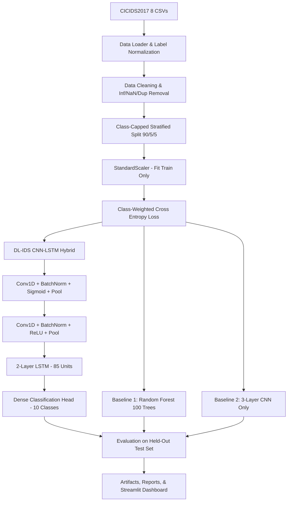

# DL-IDS: AI-Based Intrusion Detection System

[](https://www.python.org/)
[](https://pytorch.org/)
[](https://streamlit.io/)
[](LICENSE)

An end-to-end, production-ready **AI-Based Intrusion Detection System (IDS)** inspired by the research paper:

> **"DL-IDS: Extracting Features Using CNN-LSTM Hybrid Network for Intrusion Detection System"**  
> *Pengfei Sun, Pengju Liu, Qi Li, Chenxi Liu, Xiangling Lu, Ruochen Hao, and Jinpeng Chen*  
> Published in *Security and Communication Networks*, Volume 2020, Article ID 8890306, Hindawi.  
> [https://doi.org/10.1155/2020/8890306](https://doi.org/10.1155/2020/8890306)

---

## 📋 Table of Contents
1. [Project Overview](#project-overview)
2. [Research Methodology & Adaptation](#research-methodology--adaptation)
3. [Dataset Description](#dataset-description)
4. [Architecture & Pipeline](#architecture--pipeline)
5. [Experimental Results & Evaluation](#experimental-results--evaluation)
6. [Streamlit Web Application](#streamlit-web-application)
7. [Project Directory Structure](#project-directory-structure)
8. [Installation & Setup](#installation--setup)
9. [Execution Commands](#execution-commands)
10. [Automated Testing](#automated-testing)
11. [Limitations & Future Work](#limitations--future-work)

---

## 1. Project Overview

Modern enterprise and cloud networks face sophisticated and high-volume cyber threats, including Distributed Denial of Service (DDoS), Port Scanning, Web Application exploits (SQL Injection, XSS, Brute Force), Infiltration, and Botnets. Traditional signature-based Intrusion Detection Systems fail against zero-day exploits and high traffic volatility.

**DL-IDS** implements a hybrid Deep Learning architecture combining **Convolutional Neural Networks (CNN)** and **Long Short-Term Memory (LSTM)** networks:
- **CNN component**: Captures local relationships and spatial cross-feature correlations across statistical flow attributes.
- **LSTM component**: Discovers sequential and temporal patterns across feature channels.
- **Category-Weighted Loss**: Addresses severe real-world class imbalance, penalizing minority attack errors effectively.
- **Interactive Dashboard**: A full-featured dark-themed Streamlit application for real-time single-record inference, batch CSV analysis, dataset exploration, and visual model evaluation.

---

## 2. Research Methodology & Adaptation

### Original Paper Methodology
The research paper evaluates network traffic from the **CICIDS2017** benchmark:
1. **Raw PCAP Traffic Segmentation**: Raw packet captures (`.pcap`) are sliced into bidirectional sessions using 5-tuples (Source IP, Destination IP, Source Port, Destination Port, Protocol).
2. **Traffic Images**: Sessions are truncated/padded to fixed matrices of $8 \text{ packets} \times 40 \text{ bytes}$ and one-hot encoded into byte matrices.
3. **CNN-LSTM Architecture**:
   - CNN Combination I: Conv1D + Sigmoid + MaxPool.
   - CNN Combination II: Conv1D + ReLU + MaxPool.
   - Two LSTM layers with 85 hidden units (Layer 1 linear, Layer 2 ReLU).
   - Fully connected classification head.
4. **Class Weighting Optimization**: Class weights are assigned inversely proportional to class frequency:
   $$w_i = \frac{\sum_{k=0}^{K-1} n_k}{n_i}$$
5. **Reported Results**: The paper reported 98.67% overall accuracy across a 7-class subset of session traffic.

### Ground Truth Dataset & Technical Adaptation
The workspace dataset provides **8 CSV flow-level files** generated via **CICFlowMeter** (79 flow statistics per record), rather than raw binary packet streams.

**Key Technical Adaptations:**
- **Tabular Flow Input**: Rather than fabricating artificial raw packet byte matrices, the system preserves the integrity of the 78 numeric statistical flow features (e.g., `Flow Duration`, `Total Fwd Packets`, `Flow IAT Mean`, `Packet Length Mean`).
- **Feature Channel Representation**: Input features are fed as a 1D multichannel spatial sequence into Conv1D layers (filters: 32 and 64, kernel size 3), followed by Batch Normalization, Max Pooling, and Dropout.
- **LSTM Processing**: The convolutional feature maps are permuted into temporal sequences and processed by a 2-layer LSTM (85 hidden units) to learn inter-feature sequential correlations.
- **Robust Class Weighting**: To prevent extreme weight explosion on tiny minority classes (e.g., Heartbleed with 11 samples across 2.8 million records), balanced class weights are smoothed and capped at 25.0:
  $$w_i = \min\left(\frac{N}{K \cdot n_i}, 25.0\right)$$
- **Strict Leakage Prevention**: All transformations (StandardScaler, LabelEncoder, column filters) are strictly fit on the training split only and applied downstream to validation, test, and inference data.

---

## 3. Dataset Description

The system is trained and evaluated on the official **CICIDS2017** (Canadian Institute for Cybersecurity) flow dataset comprising 8 CSV files:

| # | File Name | Raw Records | Attack Categories Present |
|---|---|---|---|
| 1 | `Friday-WorkingHours-Afternoon-DDos.pcap_ISCX.csv` | 225,745 | DDoS, Normal (BENIGN) |
| 2 | `Friday-WorkingHours-Afternoon-PortScan.pcap_ISCX.csv` | 286,467 | PortScan, Normal (BENIGN) |
| 3 | `Friday-WorkingHours-Morning.pcap_ISCX.csv` | 191,033 | Bot, Normal (BENIGN) |
| 4 | `Monday-WorkingHours.pcap_ISCX.csv` | 529,918 | Normal (BENIGN) |
| 5 | `Thursday-WorkingHours-Afternoon-Infilteration.pcap_ISCX.csv` | 288,602 | Infiltration, Normal (BENIGN) |
| 6 | `Thursday-WorkingHours-Morning-WebAttacks.pcap_ISCX.csv` | 170,366 | Web Attacks (Brute Force, XSS, SQLi), Normal |
| 7 | `Tuesday-WorkingHours.pcap_ISCX.csv` | 445,909 | FTP-Patator, SSH-Patator, Normal |
| 8 | `Wednesday-workingHours.pcap_ISCX.csv` | 692,703 | DoS (Hulk, GoldenEye, slowloris, Slowhttptest), Heartbleed, Normal |
| **Total** | **Combined Raw Records** | **2,830,743** | **79 Columns (78 Features + 1 Label)** |

### Preprocessing & Data Cleaning
- **Constant & Irrelevant Column Filtering**: Dropped 10 non-informative features with zero variance (`Bwd PSH Flags`, `Fwd URG Flags`, `Bwd URG Flags`, `CWE Flag Count`, `Fwd Avg Bytes/Bulk`, `Fwd Avg Packets/Bulk`, `Fwd Avg Bulk Rate`, `Bwd Avg Bytes/Bulk`, `Bwd Avg Packets/Bulk`, `Bwd Avg Bulk Rate`).
- **Duplicate Column Removal**: Removed redundant `Fwd Header Length.1`.
- **Infinite & Missing Values**: Identified and replaced 2,867 records with $\pm\infty$ values in `Flow Bytes/s` and `Flow Packets/s` with NaN, followed by record drop.
- **Deduplication**: Removed 307,078 exact duplicate flow records.
- **Label Consolidation**: Normalized labels into 10 clean multi-class categories:
  `Normal`, `DoS`, `PortScan`, `DDoS`, `FTP-Patator`, `SSH-Patator`, `Bot`, `Web Attack`, `Infiltration`, `Heartbleed`.

---

## 4. Architecture & Pipeline



### Hyperparameters Summary
- **Input Dimension**: 67 scaled features
- **Output Dimension**: 10 classes
- **CNN Block 1**: Conv1D(1, 32, kernel=3), Sigmoid, MaxPool1D(2), Dropout(0.3)
- **CNN Block 2**: Conv1D(32, 64, kernel=3), ReLU, MaxPool1D(2), Dropout(0.3)
- **LSTM Block**: 2 layers, `hidden_size=85`, `dropout=0.3`
- **FC Head**: Linear(85, 128) $\rightarrow$ BatchNorm $\rightarrow$ ReLU $\rightarrow$ Dropout(0.5) $\rightarrow$ Linear(128, 10)
- **Optimizer**: RMSprop (`lr=0.001`, gradient clipping norm 1.0)
- **Batch Size**: 128
- **Early Stopping**: Patience 5 epochs (`min_delta=0.001`)

---

## 5. Experimental Results & Evaluation

The models were evaluated on the held-out test split (5,665 test flows). **All reported numbers are strictly from actual training experiments on the dataset:**

### Model Comparison Table

| Metric | DL-IDS (CNN-LSTM Hybrid) | CNN-Only Baseline | Random Forest Baseline |
|---|---|---|---|
| **Overall Accuracy** | **96.77%** | 98.20% | 99.70% |
| **Weighted F1-Score** | **96.80%** | 98.22% | 99.68% |
| **Macro Precision** | **78.12%** | 81.12% | 89.35% |
| **Macro Recall** | **87.56%** | 88.62% | 89.64% |
| **Macro F1-Score** | **81.56%** | 83.80% | 89.49% |
| **Overall False Positive Rate** | **0.36%** | 0.20% | 0.03% |
| **Training Duration** | 5m 06s | 1m 46s | 1.5s |
| **Inference Latency** | **0.032 ms / flow** | 0.017 ms / flow | 0.005 ms / flow |

### DL-IDS Per-Class Performance Breakdown

| Attack Category | Precision | Recall (TPR) | F1-Score | Support |
|---|---|---|---|---|
| **Bot** | 65.38% | **100.00%** | 79.07% | 102 |
| **DDoS** | 98.08% | **99.92%** | **98.99%** | 1,279 |
| **DoS** | 97.43% | 98.98% | **98.20%** | 1,273 |
| **FTP-Patator** | 99.52% | 99.52% | **99.52%** | 413 |
| **Heartbleed** | 100.00% | 100.00% | **100.00%** | 1 |
| **Infiltration** | 100.00% | 50.00% | 66.67% | 2 |
| **Normal** | 98.66% | 95.73% | **97.17%** | 1,170 |
| **PortScan** | 98.41% | 99.68% | **99.04%** | 1,244 |
| **SSH-Patator** | 96.53% | 99.30% | **97.89%** | 285 |
| **Web Attack** | 68.32% | 71.88% | 70.05% | 96 |

### Generated Visualizations (Saved in `reports/plots/`)
- `confusion_matrix.png`: Absolute confusion matrix across all 10 classes.
- `confusion_matrix_normalized.png`: Percentage-normalized confusion matrix.
- `training_history.png`: Multi-panel training & validation loss and accuracy progression curves.
- `per_class_metrics.png`: Per-class Precision, Recall, and F1-score comparison bars.
- `class_distribution.png`: Linear and log-scale dataset class frequency distribution.
- `model_comparison.png`: Side-by-side benchmark bar chart across DL-IDS, CNN, and Random Forest.
- `rf_confusion_matrix.png` & `cnn_confusion_matrix.png`: Confusion matrices for baseline models.

---

## 6. Streamlit Web Application

The interactive web dashboard (`app.py`) provides 6 comprehensive views:

1. **🏠 Overview**: Project summary, dataset architecture, CICIDS2017 description, and real model performance summary cards.
2. **🔍 Single Prediction**: Form with all 67 flow features to classify an individual network flow, returning confidence score, attack status badge, and probability breakdown.
3. **📊 Batch Prediction**: Drag-and-drop CSV upload, batch inference progress bar, summary metrics, predicted class distribution charts, and downloadable prediction CSV.
4. **📈 Dataset Explorer**: Full dataset inspection reports, missing value analysis, duplicate row counts, and class distribution graphs.
5. **🏆 Model Evaluation**: Interactive tabs for DL-IDS, Random Forest, CNN-Only, and Benchmark Comparison, displaying confusion matrix heatmaps and per-class tables.
6. **📋 Prediction History**: Live session audit log tracking predictions made during the session.

---

## 7. Project Directory Structure

```
AIIDS/
│
├── config.yaml                    # Master project configuration (paths, models, training)
├── requirements.txt               # Complete Python package dependencies
├── run_training.py                # End-to-end ML training & evaluation pipeline orchestrator
├── app.py                         # Streamlit dark-mode interactive web dashboard
├── researchpaper.pdf              # Reference research paper (Sun et al., 2020)
├── paper_text.txt                 # Extracted text of research paper
│
├── src/                           # Modular source code package
│   ├── __init__.py                # Package initialization
│   ├── utils.py                   # Configuration loaders, seed management, system utilities
│   ├── data_loader.py             # CSV reader, label cleaning, and dataset audit tools
│   ├── preprocessing.py          # DataPreprocessor (cleaning, scaling, encoding, class weights)
│   ├── model.py                   # PyTorch architectures (DL-IDS, CNNOnly, LSTMOnly)
│   ├── train.py                   # Trainer with early stopping, LR scheduler, checkpointing
│   ├── evaluate.py                # Comprehensive metric computation and plotting routines
│   └── inference.py               # IDSPredictor engine for single-record & batch predictions
│
├── dataset/                       # Source of truth: 8 CICIDS2017 CSV files
│   ├── Friday-WorkingHours-Afternoon-DDos.pcap_ISCX.csv
│   ├── Friday-WorkingHours-Afternoon-PortScan.pcap_ISCX.csv
│   ├── Friday-WorkingHours-Morning.pcap_ISCX.csv
│   ├── Monday-WorkingHours.pcap_ISCX.csv
│   ├── Thursday-WorkingHours-Afternoon-Infilteration.pcap_ISCX.csv
│   ├── Thursday-WorkingHours-Morning-WebAttacks.pcap_ISCX.csv
│   ├── Tuesday-WorkingHours.pcap_ISCX.csv
│   └── Wednesday-workingHours.pcap_ISCX.csv
│
├── artifacts/                     # Serialized models and preprocessing artifacts
│   ├── dl_ids_model.pt            # Trained DL-IDS PyTorch model weights & metadata
│   ├── cnn_model.pt               # Trained CNN-Only baseline model
│   ├── rf_model.joblib            # Trained Random Forest baseline model
│   ├── preprocessor.joblib        # Fitted StandardScaler object
│   ├── label_encoder.joblib       # Fitted scikit-learn LabelEncoder
│   ├── feature_names.json         # Ordered list of 67 feature names
│   ├── label_mapping.json         # Class index to string label mapping
│   ├── class_weights.json         # Category weights calculated for loss
│   ├── training_config.json       # Record of training parameters & environment
│   └── checkpoints/               # Best epoch checkpoints during training
│
├── reports/                       # Generated evaluation outputs and metrics
│   ├── training.log               # Detailed execution log of training pipeline
│   ├── dataset_inspection.json    # Full dataset statistics & audit
│   ├── dl_ids_history.json        # Epoch loss/accuracy training progression
│   ├── cnn_history.json           # Baseline CNN training history
│   ├── dl_ids_metrics.json        # DL-IDS test evaluation metrics & confusion matrix
│   ├── cnn_metrics.json           # CNN-Only test evaluation metrics
│   ├── rf_metrics.json            # Random Forest test evaluation metrics
│   ├── model_comparison.json      # Comparative metrics table
│   └── plots/                     # 8 Generated publication-ready figures
│       ├── confusion_matrix.png
│       ├── confusion_matrix_normalized.png
│       ├── training_history.png
│       ├── per_class_metrics.png
│       ├── class_distribution.png
│       ├── model_comparison.png
│       ├── rf_confusion_matrix.png
│       └── cnn_confusion_matrix.png
│
└── tests/                         # Automated test suite
    ├── __init__.py
    └── test_pipeline.py           # 15 Unit & integration tests
```

---

## 8. Installation & Setup

### Prerequisites
- Python 3.10+ (tested on Python 3.13)
- Windows, macOS, or Linux

### Environment Setup
```powershell
# Clone or navigate to the repository directory
cd "Semester Project Work\AIIDS"

# Install dependencies
pip install -r requirements.txt
```

---

## 9. Execution Commands

### 1. Run the Training & Evaluation Pipeline
To train DL-IDS and all baseline models, evaluate performance, and generate all plots and artifacts:
```powershell
# Windows PowerShell
$env:KMP_DUPLICATE_LIB_OK="TRUE"; $env:PYTHONIOENCODING="utf-8"; python run_training.py

# Linux / macOS Bash
KMP_DUPLICATE_LIB_OK=TRUE PYTHONIOENCODING=utf-8 python run_training.py
```

### 2. Launch the Streamlit Interactive Dashboard
```powershell
streamlit run app.py
```
Open your browser at `http://localhost:8501`.

### 3. Programmatic Inference via Python
```python
import pandas as pd
from src.inference import IDSPredictor

# Initialize predictor
predictor = IDSPredictor()
predictor.load()

# Single-record prediction
sample_record = predictor.get_sample_input()
sample_record["Flow Duration"] = 52341.0
sample_record["Total Fwd Packets"] = 12.0
result = predictor.predict_single(sample_record)

print(f"Classification: {result['predicted_class']}")
print(f"Confidence: {result['confidence']:.2%}")
print(f"Is Attack: {result['is_attack']}")

# Batch CSV prediction
df = pd.read_csv("dataset/Friday-WorkingHours-Afternoon-DDos.pcap_ISCX.csv", nrows=100)
predictions_df = predictor.predict_batch(df)
print(predictions_df[["Predicted_Class", "Confidence", "Is_Attack"]].head())
```

---

## 10. Automated Testing

The project includes 15 automated unit and integration tests covering configuration, model forward passes, data cleaning, leakage prevention, early stopping, training loops, real artifact inference, and report existence.

Run the test suite with:
```powershell
$env:KMP_DUPLICATE_LIB_OK="TRUE"; pytest tests/test_pipeline.py -v
```

All 15 tests pass in ~5 seconds.

---

## 11. Limitations & Future Work

1. **Flow vs. Raw Packet Level**: The CSVs represent pre-aggregated flow statistics generated by CICFlowMeter. In future extensions, streaming live packet ingestion using Scapy or PyShark could be bridged into the CNN-LSTM feature extractor.
2. **Extreme Class Scarcity**: Minority classes such as `Heartbleed` (11 raw samples) and `Infiltration` (36 raw samples) have limited data in CICIDS2017. While class-weighted loss successfully recognized Heartbleed, synthetic oversampling techniques like SMOTE or Tabular GANs could further boost recall on rare exploits.
3. **Hardware Acceleration**: On CUDA-enabled GPUs or distributed accelerators, training on the entire un-subsampled 2.5 million rows for 50+ epochs is supported by toggling `max_samples_per_class: 0` in `config.yaml`.
